<a href="https://aicon-hub.github.io/">
<picture>
  <source media="(prefers-reduced-motion: reduce) and (max-width: 600px) and (prefers-color-scheme: dark)" srcset="cards/hero-mobile-dark-static.svg">
  <source media="(prefers-reduced-motion: reduce) and (max-width: 600px)" srcset="cards/hero-mobile-light-static.svg">
  <source media="(prefers-reduced-motion: reduce) and (prefers-color-scheme: dark)" srcset="cards/hero-dark-static.svg">
  <source media="(prefers-reduced-motion: reduce)" srcset="cards/hero-light-static.svg">
  <source media="(max-width: 600px) and (prefers-color-scheme: dark)" srcset="cards/hero-mobile-dark.svg">
  <source media="(max-width: 600px)" srcset="cards/hero-mobile-light.svg">
  <source media="(prefers-color-scheme: dark)" srcset="cards/hero-dark.svg">
  
</picture>
</a>

    

<a href="https://aicon-hub.github.io/posts/">
<picture>
  <source media="(prefers-reduced-motion: reduce) and (max-width: 600px) and (prefers-color-scheme: dark)" srcset="cards/guides-mobile-dark-static.svg">
  <source media="(prefers-reduced-motion: reduce) and (max-width: 600px)" srcset="cards/guides-mobile-light-static.svg">
  <source media="(prefers-reduced-motion: reduce) and (prefers-color-scheme: dark)" srcset="cards/guides-dark-static.svg">
  <source media="(prefers-reduced-motion: reduce)" srcset="cards/guides-light-static.svg">
  <source media="(max-width: 600px) and (prefers-color-scheme: dark)" srcset="cards/guides-mobile-dark.svg">
  <source media="(max-width: 600px)" srcset="cards/guides-mobile-light.svg">
  <source media="(prefers-color-scheme: dark)" srcset="cards/guides-dark.svg">
  
</picture>
</a>

<picture>
  <source media="(prefers-reduced-motion: reduce) and (max-width: 600px) and (prefers-color-scheme: dark)" srcset="cards/activity-mobile-dark-static.svg">
  <source media="(prefers-reduced-motion: reduce) and (max-width: 600px)" srcset="cards/activity-mobile-light-static.svg">
  <source media="(prefers-reduced-motion: reduce) and (prefers-color-scheme: dark)" srcset="cards/activity-dark-static.svg">
  <source media="(prefers-reduced-motion: reduce)" srcset="cards/activity-light-static.svg">
  <source media="(max-width: 600px) and (prefers-color-scheme: dark)" srcset="cards/activity-mobile-dark.svg">
  <source media="(max-width: 600px)" srcset="cards/activity-mobile-light.svg">
  <source media="(prefers-color-scheme: dark)" srcset="cards/activity-dark.svg">
  
</picture>

<picture>
  <source media="(prefers-reduced-motion: reduce) and (max-width: 600px) and (prefers-color-scheme: dark)" srcset="cards/calendar-mobile-dark-static.svg">
  <source media="(prefers-reduced-motion: reduce) and (max-width: 600px)" srcset="cards/calendar-mobile-light-static.svg">
  <source media="(prefers-reduced-motion: reduce) and (prefers-color-scheme: dark)" srcset="cards/calendar-dark-static.svg">
  <source media="(prefers-reduced-motion: reduce)" srcset="cards/calendar-light-static.svg">
  <source media="(max-width: 600px) and (prefers-color-scheme: dark)" srcset="cards/calendar-mobile-dark.svg">
  <source media="(max-width: 600px)" srcset="cards/calendar-mobile-light.svg">
  <source media="(prefers-color-scheme: dark)" srcset="cards/calendar-dark.svg">
  
</picture>

<a href="https://whatsapp.com/channel/0029VawGIGTD38CRJde0fl1c">
<picture>
  <source media="(prefers-reduced-motion: reduce) and (max-width: 600px) and (prefers-color-scheme: dark)" srcset="cards/community-mobile-dark-static.svg">
  <source media="(prefers-reduced-motion: reduce) and (max-width: 600px)" srcset="cards/community-mobile-light-static.svg">
  <source media="(prefers-reduced-motion: reduce) and (prefers-color-scheme: dark)" srcset="cards/community-dark-static.svg">
  <source media="(prefers-reduced-motion: reduce)" srcset="cards/community-light-static.svg">
  <source media="(max-width: 600px) and (prefers-color-scheme: dark)" srcset="cards/community-mobile-dark.svg">
  <source media="(max-width: 600px)" srcset="cards/community-mobile-light.svg">
  <source media="(prefers-color-scheme: dark)" srcset="cards/community-dark.svg">
  
</picture>
</a>

<a href="https://t.me/AiCoN4tech">Prefer Telegram? Follow AiCoN4tech</a>

<a href="https://github.com/aicon-hub?tab=repositories">
<picture>
  <source media="(prefers-reduced-motion: reduce) and (max-width: 600px) and (prefers-color-scheme: dark)" srcset="cards/source-mobile-dark-static.svg">
  <source media="(prefers-reduced-motion: reduce) and (max-width: 600px)" srcset="cards/source-mobile-light-static.svg">
  <source media="(prefers-reduced-motion: reduce) and (prefers-color-scheme: dark)" srcset="cards/source-dark-static.svg">
  <source media="(prefers-reduced-motion: reduce)" srcset="cards/source-light-static.svg">
  <source media="(max-width: 600px) and (prefers-color-scheme: dark)" srcset="cards/source-mobile-dark.svg">
  <source media="(max-width: 600px)" srcset="cards/source-mobile-light.svg">
  <source media="(prefers-color-scheme: dark)" srcset="cards/source-dark.svg">
  
</picture>
</a>

<h3 align="center">Fresh from the guide library</h3>

<a href="https://aicon-hub.github.io/posts/icts-sn-bhatt-fellowship-2027-eligibility-15-december-guide.html">ICTS Fellowship 2027: check your course year</a> 
<a href="https://aicon-hub.github.io/posts/wormhole-expiring-file-links-sender-offline-tested-guide.html">Wormhole: temporary file links, with a sender-offline test</a> 
<a href="https://aicon-hub.github.io/posts/emigrate-recruiting-agent-check-kerala-tested-guide.html">eMigrate: check a recruiting agent before paying for an overseas job</a>

<a href="https://aicon-hub.github.io/posts/about-aicon.html">About AiCoN</a> · <a href="mailto:aicon4tech@proton.me">Corrections and contact</a>

