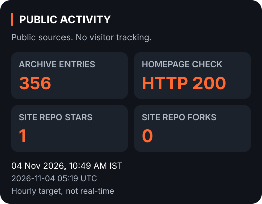
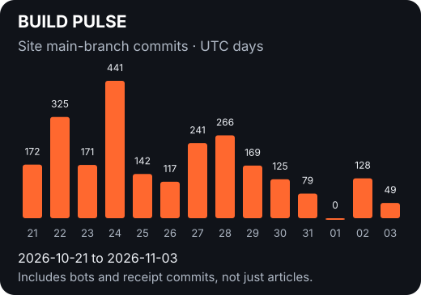
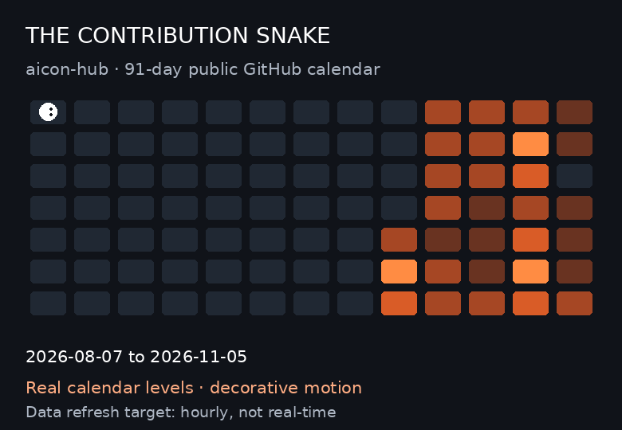

<picture>
  <source media="(prefers-color-scheme: dark)" srcset="https://aicon-hub.github.io/assets/aicon-lockup-light-text.svg">
  
</picture>

# Useful tech. Clear answers.

**Your Trusted Tech Companion**

AI · Apps · Digital safety · Scholarships · Opportunities 
Source-checked guides for Kerala and India.

[Explore the website](https://aicon-hub.github.io/) · [Browse guides](https://aicon-hub.github.io/posts/index.html) 
[WhatsApp](https://whatsapp.com/channel/0029VawGIGTD38CRJde0fl1c) · [Telegram](https://t.me/AiCoN4tech)

## On the radar

<!-- AICON:SNAPSHOT:START -->

Checked **03 Nov 2026, 02:41 PM IST** (2026-11-03 09:11 UTC).

**355 archive entries** · **Homepage HTTP 200** · **1 site-repo star(s)** · **0 site-repo fork(s)**
<!-- AICON:SNAPSHOT:END -->

## Build pulse

<!-- AICON:ACTIVITY:START -->

**2401 website-repo main-branch commits** · 14 UTC days · includes automation.
<!-- AICON:ACTIVITY:END -->

## The contribution snake

An orange-and-white snake explores **91 days of aicon-hub's public GitHub calendar**. Real calendar, playful motion. The animation is decorative, not extra activity.

<strong>Recent changes, dates and diffs</strong>

<!-- AICON:COMMITS:START -->
- [`4285b14`](https://github.com/aicon-hub/aicon-hub.github.io/commit/4285b14cc539a6dc7c3124c8ace3f1731a2d92d0) · 03 Nov 2026, 08:33 UTC · Sitemap lastmod FSSAI guide
- [`26b1681`](https://github.com/aicon-hub/aicon-hub.github.io/commit/26b1681588a2177cd2994e3dc327a8d71ce503dc) · 03 Nov 2026, 08:33 UTC · FSSAI guide: helpline hours rechecked 3 November
- [`b3a1894`](https://github.com/aicon-hub/aicon-hub.github.io/commit/b3a1894d9628be2760ef2b12c2536200105f31ac) · 03 Nov 2026, 05:23 UTC · Record Telegram publishing state
- [`a69ebfe`](https://github.com/aicon-hub/aicon-hub.github.io/commit/a69ebfe8f8bf1604c82c8c8028d5b21516040bfe) · 03 Nov 2026, 05:23 UTC · Record Telegram publishing state
- [`1545140`](https://github.com/aicon-hub/aicon-hub.github.io/commit/154514061050e4d3baf42e370d4a8a95a2ad6999) · 03 Nov 2026, 05:23 UTC · Record Telegram publishing state
<!-- AICON:COMMITS:END -->

<strong>What the tracking actually measures</strong>

- **Archive:** unique article links in the public website index, not readers.
- **Homepage:** HTTP response at the check, not an uptime guarantee.
- **Stars and forks:** the website repository only.
- **Commit graph:** reachable website-repo main-branch commits, grouped by UTC committer date over 14 calendar days. Includes bots, merges and Telegram receipts, not just articles. Today is partial. Excludes this profile repo's refresh commits.
- **Snake grid:** GitHub's publicly displayed account calendar and intensity levels, not site commit totals. GitHub applies its own contribution-credit rules. It may include anonymized private counts if the account has chosen to display them, but no private repository details are fetched. Account activity may include this profile's refresh commits after publication.
- **Refresh:** hourly target, not real-time. GitHub may delay or pause updates. Check the last-successful-check timestamp. Images may also be cached.
- **Privacy:** public pages and public metadata only. No visitor tracking or private Analytics data.

The data and update scripts live in this profile repository. [Compare with the original GitHub profile](https://github.com/aicon-hub) or [site commit history](https://github.com/aicon-hub/aicon-hub.github.io/commits/main/).

## Fresh signals

<!-- AICON:LATEST:START -->
- [Google Pomelli: AI social posts built from your business website](https://aicon-hub.github.io/posts/google-pomelli-ai-social-posts-from-business-website-guide.html)
- [Google Stitch: AI that designs app screens from a prompt](https://aicon-hub.github.io/posts/google-stitch-free-ai-app-ui-design-tool-guide.html)
- [Ensu: a free AI chat app that runs on your device, with no account](https://aicon-hub.github.io/posts/ensu-ente-free-offline-ai-chat-app-no-account-guide.html)
<!-- AICON:LATEST:END -->

---

**Read clearly. Choose carefully.** 
[About AiCoN](https://aicon-hub.github.io/posts/about-aicon.html) · [Corrections and contact](mailto:aicon4tech@proton.me)
