<a href="https://aicon-hub.github.io/">
<picture>
  <source media="(prefers-reduced-motion: reduce) and (max-width: 600px) and (prefers-color-scheme: dark)" srcset="cards/hero-mobile-dark-static.svg">
  <source media="(prefers-reduced-motion: reduce) and (max-width: 600px)" srcset="cards/hero-mobile-light-static.svg">
  <source media="(prefers-reduced-motion: reduce) and (prefers-color-scheme: dark)" srcset="cards/hero-dark-static.svg">
  <source media="(prefers-reduced-motion: reduce)" srcset="cards/hero-light-static.svg">
  <source media="(max-width: 600px) and (prefers-color-scheme: dark)" srcset="cards/hero-mobile-dark.svg">
  <source media="(max-width: 600px)" srcset="cards/hero-mobile-light.svg">
  <source media="(prefers-color-scheme: dark)" srcset="cards/hero-dark.svg">
  
</picture>
</a>

[Website](https://aicon-hub.github.io/) · [WhatsApp](https://whatsapp.com/channel/0029VawGIGTD38CRJde0fl1c) · [Telegram](https://t.me/AiCoN4tech) · [Email](mailto:aicon4tech@gmail.com)

<a href="https://aicon-hub.github.io/posts/">
<picture>
  <source media="(prefers-reduced-motion: reduce) and (max-width: 600px) and (prefers-color-scheme: dark)" srcset="cards/guides-mobile-dark-static.svg">
  <source media="(prefers-reduced-motion: reduce) and (max-width: 600px)" srcset="cards/guides-mobile-light-static.svg">
  <source media="(prefers-reduced-motion: reduce) and (prefers-color-scheme: dark)" srcset="cards/guides-dark-static.svg">
  <source media="(prefers-reduced-motion: reduce)" srcset="cards/guides-light-static.svg">
  <source media="(max-width: 600px) and (prefers-color-scheme: dark)" srcset="cards/guides-mobile-dark.svg">
  <source media="(max-width: 600px)" srcset="cards/guides-mobile-light.svg">
  <source media="(prefers-color-scheme: dark)" srcset="cards/guides-dark.svg">
  
</picture>
</a>

<picture>
  <source media="(prefers-reduced-motion: reduce) and (max-width: 600px) and (prefers-color-scheme: dark)" srcset="cards/activity-mobile-dark-static.svg">
  <source media="(prefers-reduced-motion: reduce) and (max-width: 600px)" srcset="cards/activity-mobile-light-static.svg">
  <source media="(prefers-reduced-motion: reduce) and (prefers-color-scheme: dark)" srcset="cards/activity-dark-static.svg">
  <source media="(prefers-reduced-motion: reduce)" srcset="cards/activity-light-static.svg">
  <source media="(max-width: 600px) and (prefers-color-scheme: dark)" srcset="cards/activity-mobile-dark.svg">
  <source media="(max-width: 600px)" srcset="cards/activity-mobile-light.svg">
  <source media="(prefers-color-scheme: dark)" srcset="cards/activity-dark.svg">
  
</picture>

<picture>
  <source media="(prefers-reduced-motion: reduce) and (max-width: 600px) and (prefers-color-scheme: dark)" srcset="cards/calendar-mobile-dark-static.svg">
  <source media="(prefers-reduced-motion: reduce) and (max-width: 600px)" srcset="cards/calendar-mobile-light-static.svg">
  <source media="(prefers-reduced-motion: reduce) and (prefers-color-scheme: dark)" srcset="cards/calendar-dark-static.svg">
  <source media="(prefers-reduced-motion: reduce)" srcset="cards/calendar-light-static.svg">
  <source media="(max-width: 600px) and (prefers-color-scheme: dark)" srcset="cards/calendar-mobile-dark.svg">
  <source media="(max-width: 600px)" srcset="cards/calendar-mobile-light.svg">
  <source media="(prefers-color-scheme: dark)" srcset="cards/calendar-dark.svg">
  
</picture>

**Snapshot checked 19 Nov 2026, 07:26 AM IST.** Public data only. Hourly refresh target, not real-time.

<a href="https://whatsapp.com/channel/0029VawGIGTD38CRJde0fl1c">
<picture>
  <source media="(prefers-reduced-motion: reduce) and (max-width: 600px) and (prefers-color-scheme: dark)" srcset="cards/community-mobile-dark-static.svg">
  <source media="(prefers-reduced-motion: reduce) and (max-width: 600px)" srcset="cards/community-mobile-light-static.svg">
  <source media="(prefers-reduced-motion: reduce) and (prefers-color-scheme: dark)" srcset="cards/community-dark-static.svg">
  <source media="(prefers-reduced-motion: reduce)" srcset="cards/community-light-static.svg">
  <source media="(max-width: 600px) and (prefers-color-scheme: dark)" srcset="cards/community-mobile-dark.svg">
  <source media="(max-width: 600px)" srcset="cards/community-mobile-light.svg">
  <source media="(prefers-color-scheme: dark)" srcset="cards/community-dark.svg">
  
</picture>
</a>

[Prefer Telegram? Follow AiCoN4tech](https://t.me/AiCoN4tech)

<a href="https://github.com/aicon-hub?tab=repositories">
<picture>
  <source media="(prefers-reduced-motion: reduce) and (max-width: 600px) and (prefers-color-scheme: dark)" srcset="cards/source-mobile-dark-static.svg">
  <source media="(prefers-reduced-motion: reduce) and (max-width: 600px)" srcset="cards/source-mobile-light-static.svg">
  <source media="(prefers-reduced-motion: reduce) and (prefers-color-scheme: dark)" srcset="cards/source-dark-static.svg">
  <source media="(prefers-reduced-motion: reduce)" srcset="cards/source-light-static.svg">
  <source media="(max-width: 600px) and (prefers-color-scheme: dark)" srcset="cards/source-mobile-dark.svg">
  <source media="(max-width: 600px)" srcset="cards/source-mobile-light.svg">
  <source media="(prefers-color-scheme: dark)" srcset="cards/source-dark.svg">
  
</picture>
</a>

### Fresh from the guide library

- [Eat Right Photography Contest 2026: FSSAI cash awards, apply by 18 December](https://aicon-hub.github.io/posts/eat-right-photography-contest-2026-fssai-18-december-guide.html)
- [KILE IAS Academy Talent Search 2026: online test on 22 November](https://aicon-hub.github.io/posts/kile-ias-talent-search-2026-online-test-22-november-qualified-guide.html)
- [INSPIRE-SHE 2025: eligibility, subjects, benefits and how to apply by 7 December 2026](https://aicon-hub.github.io/posts/inspire-she-2025-december-2026-access-guide.html)

What these numbers measure

- **Guide links:** unique article links in the public archive, not readers or visits.
- **Build pulse:** website main-branch commits over fourteen UTC dates, including bots, merges and Telegram receipts. The current day is partial. Profile refresh commits are excluded.
- **Calendar:** GitHub's publicly displayed account calendar over 91 days. Colour intensity follows GitHub, not website commits. If anonymised private counts are displayed by the account, they may appear; no private repository details are fetched.
- **Motion:** decorative. The moving trail and calendar highlights are not extra contributions. Chart motion changes opacity, not the values or bar heights. Reduced-motion preferences turn motion off.
- **Freshness:** the last successful check is printed above. Failed refreshes keep the previous snapshot. GitHub may delay workflows or cache images.
- **Sources:** [public guide archive](https://aicon-hub.github.io/posts/), [website history](https://github.com/aicon-hub/aicon-hub.github.io/commits/main/), [GitHub calendar](https://github.com/users/aicon-hub/contributions). No analytics or visitor data.

[About AiCoN](https://aicon-hub.github.io/posts/about-aicon.html) · [Corrections and contact](mailto:aicon4tech@proton.me)
